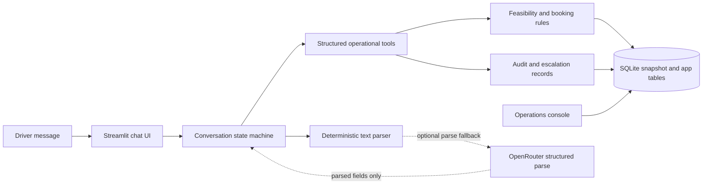

# SetuHaul Driver Chat and Slot Booking Demo

A replayable driver-chat demo backed by deterministic Python and SQLite booking
rules. The conversation layer can explain and collect information, but only the
booking engine decides whether a slot is feasible or can be held.

## Requirements

- Python 3.11 or newer
- The supplied SQLite snapshot at `data/setuhaul_freight_operations.db`
- `pytest==9.2.0` for tests
- `pandas==3.0.6` for the color-coded dock board
- `streamlit==1.65.0` for the UI

SQLite is included with Python.

The optional language-model fallback uses Python's standard library and
OpenRouter. It is not needed for the scripted agent, UI demo, tests, or
scenario replay.

## Setup

From the project root:

```bash
python3 -m venv .venv
source .venv/bin/activate
python -m pip install -r requirements.txt
```

Confirm the database snapshot exists:

```text
data/setuhaul_freight_operations.db
```

The app's default database is the working snapshot at that path. Chat messages,
agent audit events, bookings, and escalations written through the UI persist in
that database. For a clean demo, restore it from an untouched copy of the
provided snapshot before running the UI.

## Run the UI

```bash
PYTHONPATH=src streamlit run src/setuhaul/ui/app.py
```

The left pane lets you choose a seeded driver thread, send a message or use a
quick reply, and inspect its transcript. The right pane provides a facility
selector, dock availability summary, escalation list, audit events, and an
integrity check. Driver messages may be in English, Hindi, or Hinglish; agent
replies are in English. The simulated clock is set to the snapshot date for
reproducibility.

## Run tests

Run the test suite (agent, booking-state, and scheduler tests):

```bash
PYTHONPATH=src python -m pytest -q
```

Run the separate-connection concurrency proof:

```bash
PYTHONPATH=src python -m tests.test_concurrency
```

The concurrency proof uses a disposable copy of the snapshot and reports five
races. It should report one winner and one `SLOT_TAKEN` loser for each race, and
finish with `5/5 trials confirmed: no double booking, ever.` Test output is
saved in `docs/evidence/`.

## Run the scripted scenario

```bash
PYTHONPATH=src python -m setuhaul.scenarios
```

The replay copies the supplied snapshot to a temporary working database,
exercises clarification, slot comparison, competition, stale options, and
human escalation, then removes the working copy. It writes:

- `scenarios/phase6_transcript.txt`
- `scenarios/phase6_summary.json`

The current recorded replay reports a 25-minute simulated run, one of three
driver-thread outcomes resolved without takeover, zero conflicting allocations,
one previously shown option becoming unavailable, four clarification turns,
13.21% slot utilization, and two escalations. The JSON summary includes metric
definitions; priority reordering is not exercised by this conversation run.

## Optional facility schedule proposal

```bash
PYTHONPATH=src python -m setuhaul.scheduler_scenario
```

This compares a transparent earliest-feasible-start rule (priority breaks
ties) with an FCFS baseline for `SHP1002`, `SHP1003`, `SHP1004`, and `SHP1006`.
The in-progress `SHP1002` unload stays fixed. The run writes a scorecard and
proposal to `scenarios/phase8_scheduler_comparison.md` and `.json`. It is only
a proposal; it does not reserve or change appointments. CP-SAT is omitted
because this case has three movable shipments and the simple rule ties the
FCFS scorecard.

## Architecture



The model fallback, when configured, only proposes parsed message fields. It
does not determine capacity, priority, or booking state. SQLite transactions
and uniqueness constraints protect slot allocation.

## Known boundaries

- ETAs are declared by drivers; this demo has no live GPS feed.
- The scripted parser and scenario are the deterministic baseline. The optional
  LLM fallback is a parsing aid, not a fully autonomous tool-calling agent.
- Coordinators receive escalations, but spike-time coordinator capacity has not
  been measured or load-tested.
- The local UI and SQLite snapshot are a demo architecture, not a
  production-ready multi-user deployment. See
  [the client readout](docs/06_client_readout.md) for production considerations.
- The current test suite is focused and small; it is not a full acceptance
  suite for every booking state or UI interaction.
